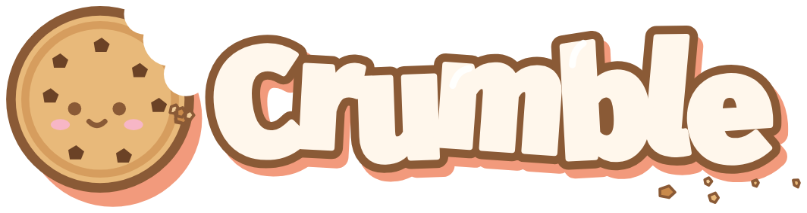

<p align="center"></p>

**한국어** · [English](#english)

# Crumble

캐릭터 카드에서 데려온 직원들이 작은 디저트 가게에서 **자기 성격대로** 일하는 경영 게임 확장이에요. 사용자는 사장이고, 가게는 **망할 수도 있어요.**

## 이런 게임이에요

- **가게 안을 구경해요.** 비스듬히 내려다보는 작은 가게에서 직원들이 오븐에서 굽고, 계산대에서 주문을 받고, 바닥을 닦고, 가끔 몰래 케이크를 먹어요. 끌어서 둘러보고 두 손가락으로 확대할 수 있어요.
- **하루 5~10분.** 🌅 아침 준비(재료·가격) → ☕ 영업(사건이 "!"로 떠요) → 🌙 마감 정산(번 돈, 직원 일기).
- **사장님이 없을 때도 가게는 돌아가요.** 다시 켜면 그동안 있었던 일이 일지로 정리돼 있어요 (최대 3일치). 자리 비운 사이에 망하지는 않아요.
- **능력과 성격은 따로.** 제빵·접객 능력은 자라지만 성격은 카드 그대로예요. 유능한 직원도 사고를 칠 수 있어요.
- **친해진다고 쉬워지지 않아요.** 관계는 대사와 태도를 바꾸지만 숫자 보너스는 없어요.
- **결재함**: 신메뉴 제안, 불만, 급전 대출 같은 큰 결정은 최대 3개까지 쌓여요.
- **폐업**: 빚진 채로 영업한 날이 3일 쌓이면 문을 닫아요. 직원들의 마지막 한마디와 폐업 일지가 남고, 새 가게를 열 수 있어요.

## 설치

실리태번 → 확장(Extensions) → **Install extension** 에 이 주소를 넣어요:

```
https://github.com/Near7707/Crumble
```

설치 뒤 확장 메뉴(마법봉)에서 **Crumble**을 누르면 창이 열려요.

## 설정

확장 설정 칸의 **Crumble**에서:

- **언어**: 자동(실리태번 언어) / 한국어 / English — AI가 쓰는 글도 이 언어로 나와요.
- **AI 연결**: 지금 연결 그대로(기본) / 실리태번 연결 프로필 중 하나. 게임 글만 그 프로필로 보내고, 채팅 연결은 바꾸지 않아요. 고른 프로필을 못 찾으면 지금 연결 그대로 써요.
- **원본 카드 참고**: 직접 영업 전부(기본) / 중요 장면만 / 안 함. 자동 일지·마감 일기·장면 말풍선은 언제나 직원 설명서만 써요.
- **영업 시간 길이**, **AI 응답 길이**, **바로 다음 날 영업하기**, **확대 위치 기억하기**

## AI 호출

- 고용할 때 1번 (직원 설명서 만들기)
- 직접 영업 하루에 2번 (아침에 대사·사건 글 / 마감에 일기)
- 다시 켰을 때 자동 운영 일지 1번, 폐업 때 1번
- 가게 장면 속 움직임·아이콘은 전부 규칙으로 정해서 AI를 부르지 않아요.
- AI가 응답하지 않으면 기본 대사로 계속 진행돼요.

기본은 지금 연결된 API를 그대로 쓰고, 설정의 **AI 연결**에서 게임용 연결 프로필을 따로 고를 수 있어요 (싸고 빠른 모델은 게임에, 채팅은 원래 모델로).

## 저장

- 가게 기록은 실리태번 확장 설정 안에 따로 저장돼요.
- **직원 설명서**(원래 어떤 사람인가)와 **가게 기억**(관계·사건)은 따로 저장해요. 설명서를 다시 뽑아도 가게 기억은 그대로예요.
- 원본 캐릭터 카드와 채팅 기록은 **읽기만 하고 절대 고치지 않아요.**

## 앞으로

- 3단계: 성격대로 돌아다니기, 직원끼리 마주치면 대화, 얼룩 눌러 치우기, 가구 사서 꾸미기, 가게 넓히기(11×9 → 13×10 → 15×12)
- 4단계: 직원별 전용 미니 그림

## 라이선스

AGPL-3.0. 로고 글자는 Fira Sans Black(SIL OFL) 글자 모양을 바탕으로 다듬어 그림으로 만들었어요.

---

<a id="english"></a>

**English**

# Crumble

A shop-management extension for SillyTavern: characters from your character cards work at a tiny dessert shop — **in their own personalities**. You are the boss, and the shop **can go under.**

## What it is

- **Watch the shop.** A small isometric shop where your staff bake at the oven, take orders at the counter, mop the floor, and sometimes sneak a slice of cake. Drag to look around, pinch to zoom.
- **5–10 minutes a day.** 🌅 Morning prep (stock & prices) → ☕ Business (events pop up as "!") → 🌙 Closing (earnings, staff diaries).
- **The shop runs while you're away.** When you come back, a log of what happened is waiting (up to 3 days). The shop can't go bankrupt while you're gone.
- **Skills ≠ personality.** Baking and service grow; personality stays true to the card. Even a pro can cause trouble.
- **Friendship doesn't make it easy.** Bonds change dialogue and attitude, never the numbers.
- **Inbox**: big decisions — new menu ideas, complaints, emergency loans — pile up (max 3).
- **Closing down**: three business days in debt and the shop closes. Your staff say their last words, a closing log is kept, and you can open a new shop.

## Install

SillyTavern → Extensions → **Install extension**, paste:

```
https://github.com/Near7707/Crumble
```

Then open **Crumble** from the extensions (wand) menu.

## Settings

Under **Crumble** in the extension settings:

- **Language**: Auto (SillyTavern language) / 한국어 / English — AI-written text follows this too.
- **AI connection**: Current connection (default) / one of your SillyTavern connection profiles. Only game text goes through that profile; your chat connection is never switched. If the profile is missing, the current connection is used.
- **Use original card text**: all of direct business (default) / important scenes only / off. Away logs, diaries and speech bubbles always use the staff manual only.
- **Business length**, **AI response length**, **skip to next day**, **remember zoom**

## AI calls

- 1 per hire (writing the staff manual)
- 2 per business day (morning lines & event text / closing diaries)
- 1 for the away log when you return, 1 for the closing-down ending
- Movement and icons in the shop scene are rule-based — no AI calls.
- If the AI doesn't answer, the game continues with default lines.

By default it uses whatever API you're currently connected to. Pick a separate connection profile under **AI connection** to run the game on a cheaper/faster model while chatting with your usual one.

## Saving

- Shop data is stored separately inside SillyTavern's extension settings.
- **Staff manuals** (who they are) and **shop memories** (bonds, events) are saved separately. Re-reading a manual keeps shop memories.
- Your character cards and chats are **read-only — never modified.**

## License

AGPL-3.0. The logo lettering is based on Fira Sans Black (SIL OFL) letterforms, reshaped and baked into an image.
